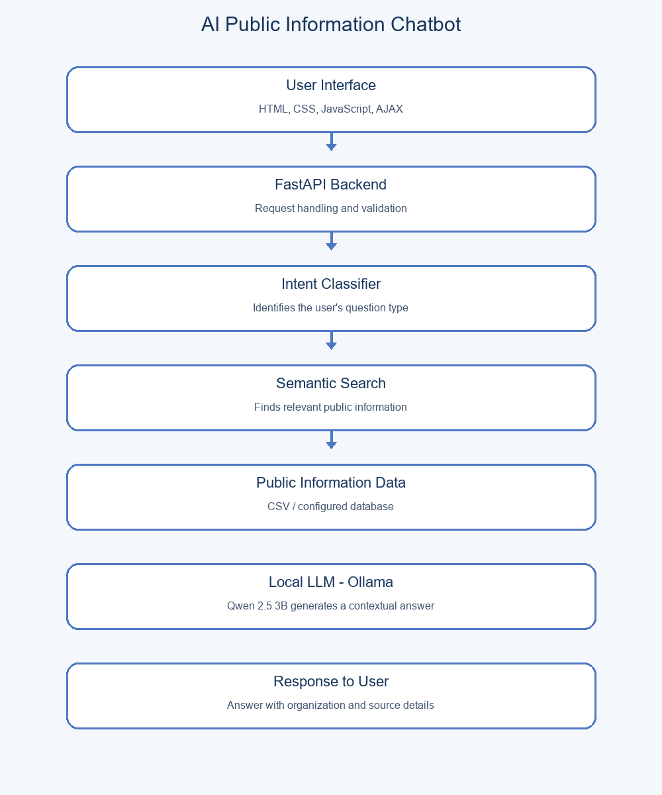

# AI-Powered Public Information Chatbot

## 1. Project Overview

The AI-Powered Public Information Chatbot is a web-based application designed to help users access public information through natural-language questions. It combines database search, intent classification, and a locally running Large Language Model (LLM) to generate readable responses based on available information.

The system uses FastAPI for backend processing, a CSV dataset for public information, and Ollama with Qwen 2.5 3B for local AI response generation.

## 2. Objectives

- Provide an easy way to access public information.
- Identify the intent behind a user's question.
- Retrieve relevant information from a structured dataset.
- Generate clear responses using a local AI model.
- Display the organization and source associated with a response.

## 3. Features

- Natural-language question answering
- Intent classification
- CSV-based public information storage
- Keyword-based information retrieval
- Local LLM integration using Ollama
- Source information in responses
- Web-based chatbot interface
- FastAPI backend and health endpoint

## 4. Technologies Used

| Component | Technology |
|---|---|
| Frontend | HTML, CSS, JavaScript |
| Backend | Python, FastAPI |
| Data storage | CSV, Pandas |
| Intent classification | Python rule-based classifier |
| Information retrieval | Keyword-based search |
| Local language model | Qwen 2.5 3B |
| Local model runtime | Ollama |

## 5. System Architecture

1. The user enters a question through the website.
2. The frontend sends the question to the FastAPI backend.
3. The intent classifier identifies the question category.
4. The search module retrieves matching records from the CSV dataset.
5. The retrieved information is passed to the local LLM.
6. The LLM generates a response using the supplied context.
7. The website displays the answer and source information.

## 6. Project Structure

```text
public-info-chatbot/
├── app/
│   ├── main.py
│   ├── llm_service.py
│   ├── intent_classifier.py
│   └── semantic_search.py
├── data/
│   └── public_info.csv
├── models/
├── static/
├── templates/
├── tests/
├── .env.example
├── .gitignore
├── README.md
└── requirements.txt
```

## 7. Requirements

- Python 3.10 or later
- Ollama
- Qwen 2.5 3B model
- pip
- A modern web browser

## 8. Installation and Execution

### Step 1: Clone the repository

```bash
git clone YOUR_GITHUB_REPOSITORY_URL
cd public-info-chatbot
```

### Step 2: Create a virtual environment

```bash
python -m venv .venv
```

### Step 3: Activate the environment on Windows

```powershell
.venv\Scripts\Activate.ps1
```

### Step 4: Install dependencies

```bash
python -m pip install -r requirements.txt
```

### Step 5: Install and start Ollama

Install Ollama from:

https://ollama.com/download/windows

Download the model:

```bash
ollama pull qwen2.5:3b
```

### Step 6: Start the chatbot

```bash
python -m uvicorn app.main:app --reload
```

Open the website:

http://127.0.0.1:8000

API documentation:

http://127.0.0.1:8000/docs

## 9. Testing

Test the chatbot with questions such as:

- How can I get library membership?
- Where is the library located?
- What services are available?
- What are the operating hours?

Check whether the retrieved organization, answer, and source match the dataset.

## 10. Limitations

- Answer accuracy depends on the completeness and quality of the dataset.
- The current search method uses keyword matching and may miss related phrases.
- The local LLM requires sufficient computer resources.
- The application does not guarantee that stored information is current.
- Demo records and placeholder URLs must be replaced with verified official information.

## 11. Future Enhancements

- Add more verified public information sources.
- Improve retrieval using semantic embeddings.
- Add conversation history and multilingual support.
- Introduce an administrative interface for updating information.
- Add automated tests and retrieval evaluation metrics.

## 12. Responsible Use

Use verified public sources and avoid storing unnecessary personal information. The chatbot should clearly indicate when information is unavailable rather than inventing official details.

## 13. License

Choose and add an appropriate open-source license before publishing this project.
## System Architecture

The AI-Powered Public Information Chatbot follows a modular architecture. The frontend accepts user queries, the FastAPI backend processes requests, and the intent classifier and semantic search identify relevant public information. A locally running Ollama LLM generates contextual responses for the user.


